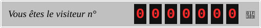

<!-- Si tu lis ce commentaire, tu es allé·e trop loin. Fais demi-tour. -->

<p align="center">
  
</p>

<p align="center">
  
</p>

<p align="center">
  
</p>

<p align="center">
  
</p>

<p align="center">
  
  
  
</p>

---

## ⚠️ Avertissement

> Ce README n'est **pas** professionnel.
> Il n'a **aucun** but.
> Il a été écrit à 2h du mat'. Ça se voit.
> Si vous êtes recruteur·se : bonjour 👋 non.

---

## 🧘 Voici Aristide

```text
          _______
      .-''       ''-._
     /  o            '-.
    ( ()                )
     '-._             _.'
         | |'-----'| |
         |_|       |_|
```

Aristide est mon capybara de soutien émotionnel. Oui, il s'appelle Aristide. Non, il n'a pas choisi.
Il review toutes mes pull requests. Il approuve tout. Il ne lit rien.
Aristide a déjà mergé en prod un vendredi à 17h59. Aristide n'a aucun regret.

---

## 🧃 `whoami`

```js
const maelys = {
  espèce: "humaine (non confirmé par la science)",
  habitat: "sous un plaid, à 2h du mat, avec 47 onglets ouverts",
  carburant: "du chaos et de la pure audace",
  languesMachines: ["JavaScript", "TypeScript", "PHP", "SQL", "Python", "Java (on se vouvoie)"],
  superPouvoir: "trouver un point-virgule manquant en 4h au lieu de 5",
  faiblesse: "centrer une div. et les escaliers.",
  phraseCulte: "attends, je relance le serveur",
  phraseCulte2: "nan mais ça marchait y'a 5 minutes",
  nombreDOngletsOuverts: Infinity,
  dormir: undefined,
};
```

<p align="center">
  
  <br>
  <i>ma tête quand le build passe du premier coup</i>
</p>

---

## 🎒 Mon inventaire

| Objet | Rareté | Description |
|---|---|---|
| 🧠 Deux neurones | 🌈 Mythique | Ils se battent pour la 3e place |
| ⚛️ React + TypeScript | 🟣 Épique | Les erreurs TypeScript font 40 lignes et je les lis jamais |
| 🟢 Node.js + Express | 🔵 Rare | Il ne me juge pas. Lui. |
| 🐘 PHP + WordPress/Elementor | 🟢 Commun | J'ai déjà vu des choses. Des choses avec Elementor. |
| 🐍 Python | 🔵 Rare | Indentation 1 – Maelys 0 |
| 🫠 Java | ⚪ Cassé | On se croise, on se salue, on se comprend pas |
| 🍊 Une orange | 🟡 Légendaire | Aucune utilité. Je la garde quand même. |
| 🧦 Chaussette seule | 🟤 Maudit | Sa jumelle est partie avec mes `node_modules` |

<p align="center">
  
</p>

---

## 🏆 Succès débloqués

- [x] 🥇 **Hello World** — a affiché du texte. Incroyable.
- [x] 🐛 **Entomologiste** — a créé plus de bugs que de features
- [x] 🔥 **Pyromane** — a cassé la prod d'un projet qui n'avait pas de prod
- [x] 🧊 **Sang-froid** — est restée calme devant une erreur de 300 lignes (en pleurant intérieurement)
- [x] 🪦 **Nécromancienne** — a ressuscité un projet abandonné depuis 3 jours
- [x] 📛 **Nommeuse de variables** — a appelé une variable `truc2Final`
- [ ] 🎯 **Centreuse de div** — *verrouillé*
- [ ] 😴 **Dormir avant minuit** — *succès introuvable*
- [ ] 🧹 **Supprimer ses console.log** — *0,01 % des joueurs l'ont débloqué*

---

## 📈 Ma productivité réelle

```text
Lundi       ████████████████████  100%  "cette semaine je suis productive"
Mardi       █████████████░░░░░░░   65%  "ok j'ai eu un bug"
Mercredi    ██████░░░░░░░░░░░░░░   30%  "le bug était un point-virgule"
Jeudi       ██░░░░░░░░░░░░░░░░░░   10%  *réorganise ses dossiers au lieu de coder*
Vendredi    ░░░░░░░░░░░░░░░░░░░░    0%  *renomme des variables pour le plaisir*
2h du mat   ████████████████████████████ 140%  *code tout le projet d'un coup*
```

---

## 🐞 Patch notes de ma vie

<details>
<summary><b>v0.0.1-beta-pas-stable — Cliquer à vos risques et périls</b></summary>

<br>

```diff
+ Ajout : Aristide (capybara, mascotte, aucune compétence)
+ Ajout : la capacité de dire "c'est pas un bug, c'est une feature"
+ Ajout : 14 onglets Stack Overflow ouverts en permanence
~ Modif : "je vais me coucher tôt" → déprécié
~ Modif : sommeil passé de "nécessaire" à "optionnel"
- Suppression : 47 console.log("ici") (il en reste 312)
- Suppression : ma confiance en Java
! Bug connu : la div n'est toujours pas centrée
! Bug connu : explique super bien le code dans sa tête, beaucoup moins à l'oral
! Bug connu : Aristide a accès en écriture au repo
```

</details>

---

## ❓ FAQ

**Q : Pourquoi ton code marche ?**
R : Je ne sais pas, et je ne touche plus à rien.

**Q : Pourquoi ton code ne marche pas ?**
R : Je ne sais pas non plus. J'ai une théorie qui implique Mercure rétrograde.

**Q : Tu dors quand ?**
R : Question suivante.

**Q : Tabs ou espaces ?**
R : Prettier décide. Je ne suis qu'une messagère.

**Q : C'est quoi ton framework préféré ?**
R : La sieste.

---

## 📊 Stats (ne jugez pas)

<p align="center">
  
  
</p>

<p align="center">
  
</p>

---

## 🐍 Un serpent mange mes contributions

<p align="center">
  <picture>
    <source media="(prefers-color-scheme: dark)" srcset="https://raw.githubusercontent.com/Maelys-B/Maelys-B/output/github-contribution-grid-snake-dark.svg" />
    
  </picture>
</p>

<p align="center"><i>(il a faim, poussez du code svp)</i></p>

---

<p align="center">
  
</p>

<p align="center">
  
</p>

<p align="center">
  
</p>

<p align="center"><sub>Ce README a été testé sur ma machine. Et validé par Aristide. ✔️</sub></p>
